# ShinyCommander

A modern, keyboard-first, dual-pane file manager in the spirit of Total Commander — built with .NET MAUI for
**Windows** (WinUI), **macOS** (native AppKit via [maui-labs](https://github.com/dotnet/maui-labs), not Catalyst)
and **Linux** (GTK4 via maui-labs), and dressed in [Shiny Controls](https://github.com/shinyorg/controls).

**[shinysoftware.github.io/Commander](https://shinysoftware.github.io/Commander/)** · [Download](https://github.com/ShinySoftware/Commander/releases/latest)

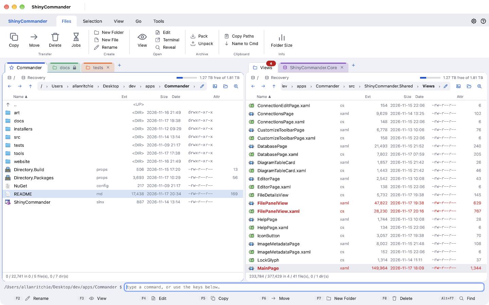

| | |
|---|---|
| 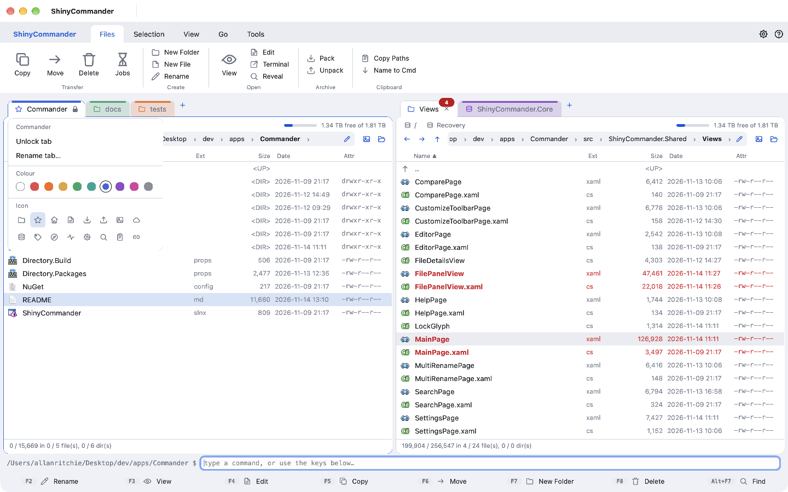<br>**Folder tabs** - lock, rename, colour and give each tab an icon | 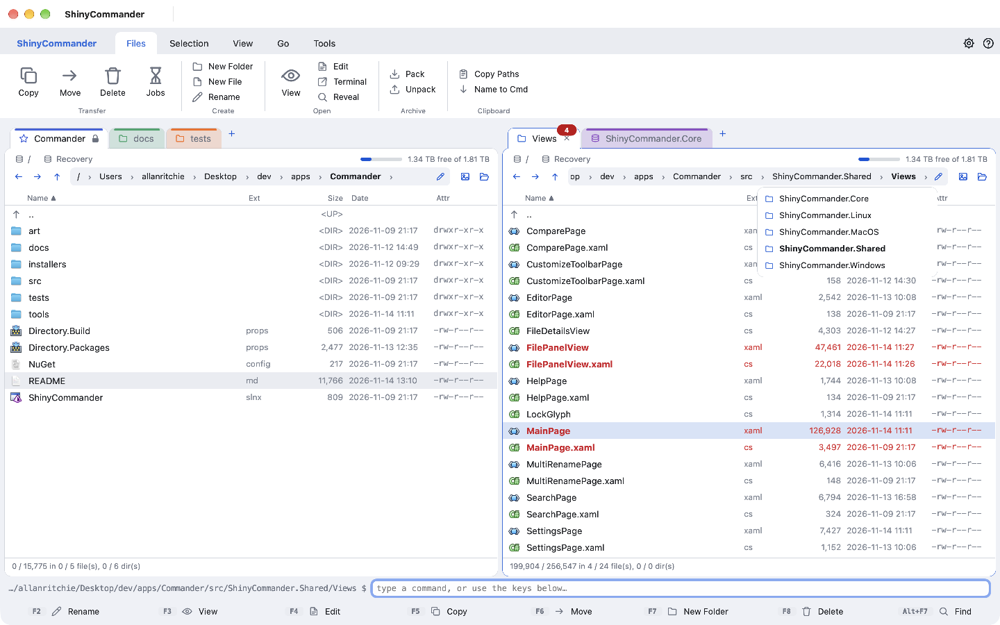<br>**Breadcrumbs** - every crumb drops down the folders inside it |
| 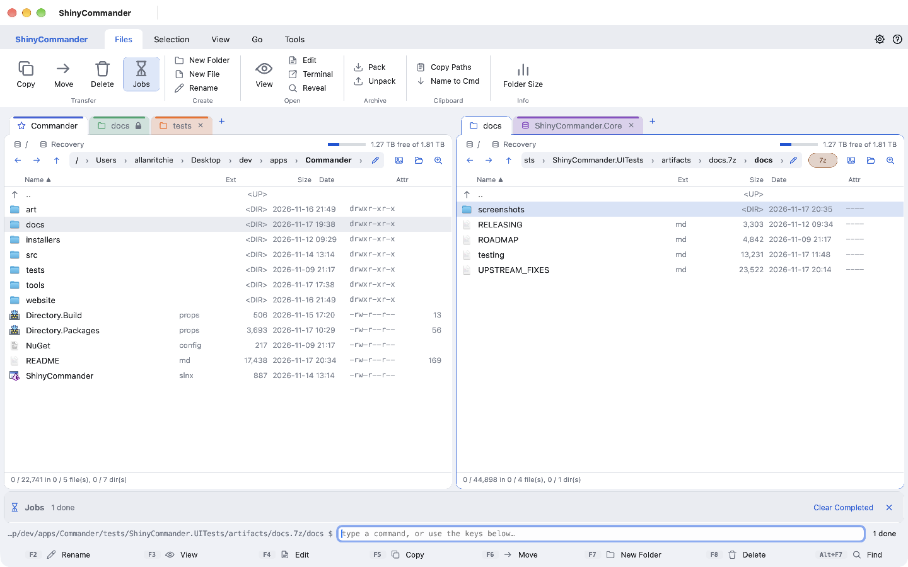<br>**Archives as folders** - zip, 7z and tar, changed in place | 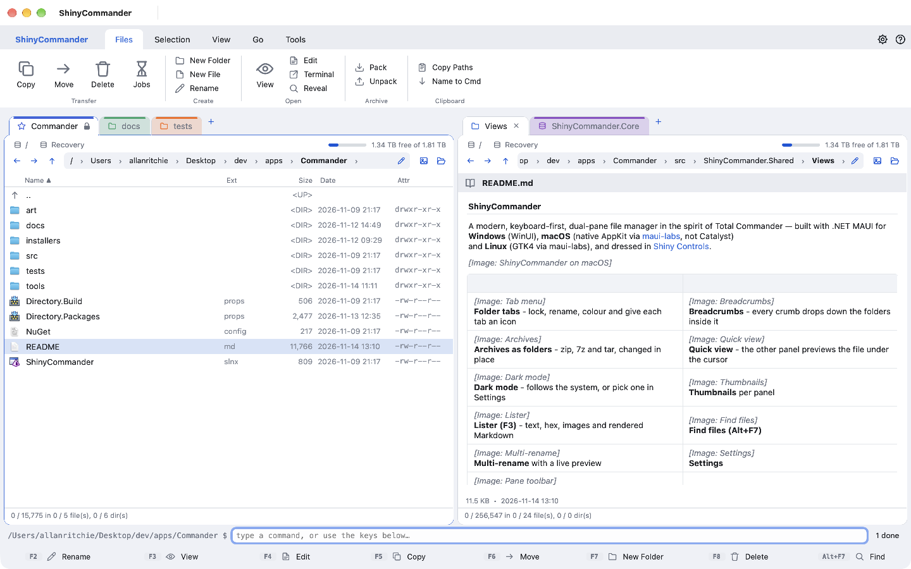<br>**Quick view** - the other panel previews the file under the cursor |
| 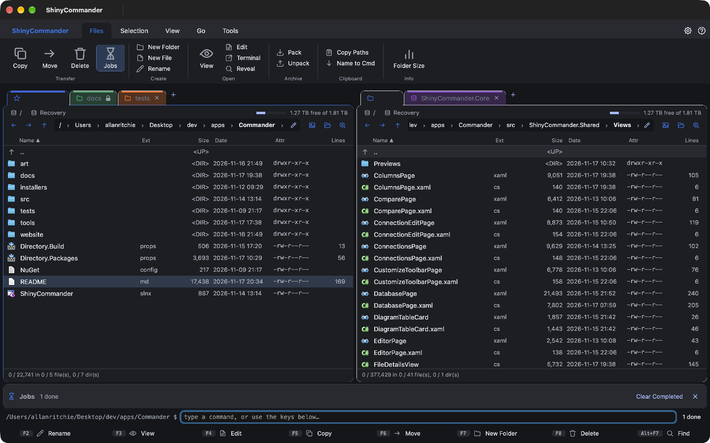<br>**Dark mode** - follows the system, or pick one in Settings | 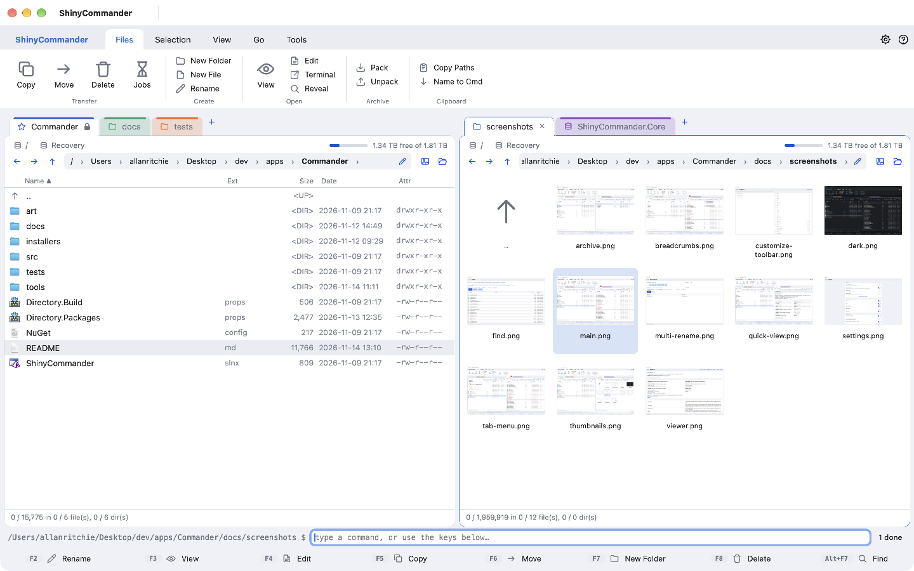<br>**Thumbnails** per panel |
| 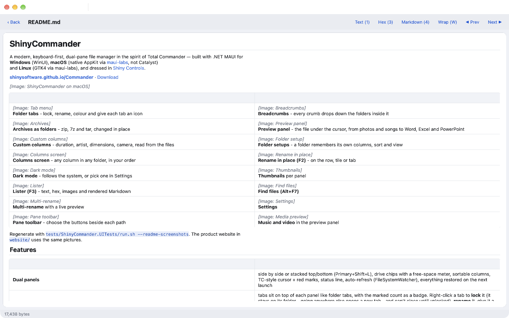<br>**Lister (F3)** - text, hex, images and rendered Markdown | 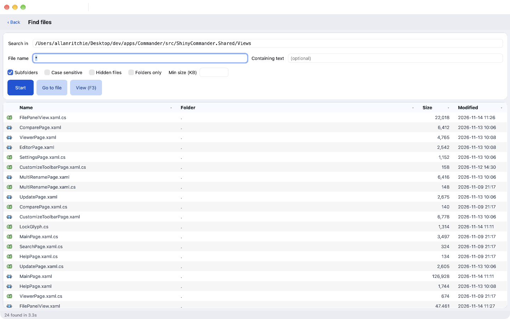<br>**Find files (Alt+F7)** |
| 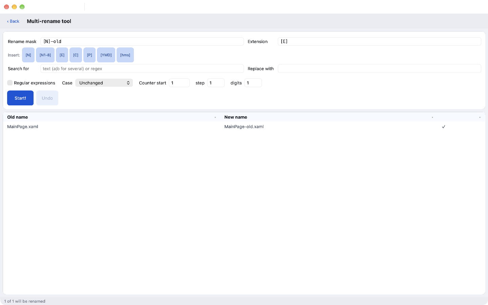<br>**Multi-rename** with a live preview | 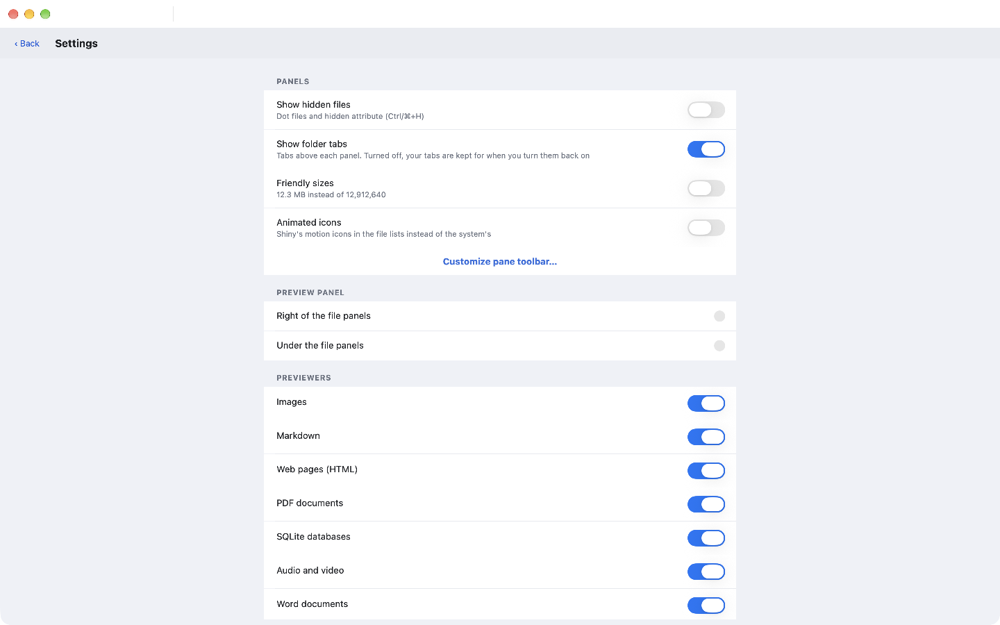<br>**Settings** |
| 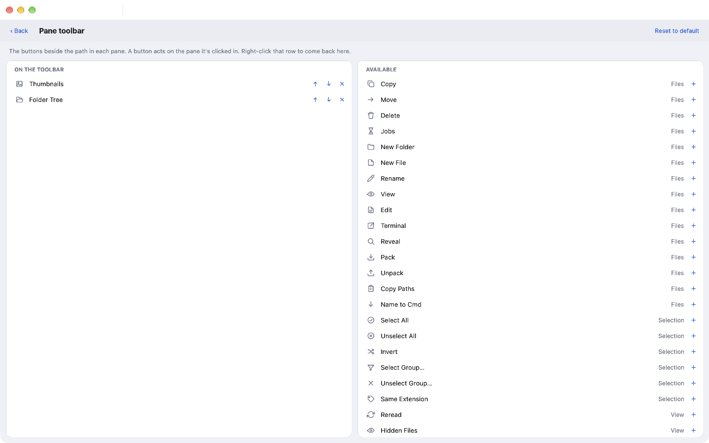<br>**Pane toolbar** - choose the buttons beside each path | |

<sub>Regenerate with `tests/ShinyCommander.UITests/run.sh --readme-screenshots`. The product website in
[`website/`](website) uses the same pictures.</sub>

## Features

| | |
|---|---|
| **Dual panels** | side by side or stacked top/bottom (Primary+Shift+L), drive chips with a free-space meter, sortable columns, TC-style cursor + red marks, status line, auto-refresh (FileSystemWatcher), everything restored on the next launch |
| **Folder tabs** | tabs sit on top of each panel like folder tabs, with the marked count as a badge. Right-click a tab to **lock** it (it stays on its folder - going anywhere else opens a new tab - and can't close until unlocked), **rename** it, give it a **colour** and an **icon**. Home, Desktop, Documents, Downloads and cloud folders start as locked tabs. Tabs can be turned off in Settings |
| **Breadcrumbs** | the path is a breadcrumb trail: click a crumb to go there, click its `›` to drop down the folders inside it, or click the pencil to type a path |
| **Views** | details or thumbnails per panel (Primary+Shift+F1 / Primary+F2), column chooser incl. date created (Primary+Shift+K), an optional folder tree in each panel that follows the panel's folder and resizes with a drag (Primary+F8), quick view - the other panel previews the file under the cursor (Ctrl+Q) |
| **Keyboard** | the full TC keymap (F2–F8, Insert/Space/Shift-arrows marking, Tab, Backspace, Alt+F7, Ctrl+B/R/H/T/W/U/D…) via Shiny's cross-platform keyboard-shortcut engine; `Primary` = ⌘ on Mac, Ctrl elsewhere. F1 shows a reference generated from the live shortcut registry |
| **Command line** | typing goes to the command line; `cd` is handled internally, everything else runs through the system shell with output streamed into a console pane |
| **Archives** | Enter opens an archive like a folder. **zip** (+ jar/nupkg/docx/apk/…), **7z**, **tar**, **tar.gz**, **tar.bz2** and **tar.zst** work like folders: copy and move in and out (archive to archive too), delete, rename, move within, new folder, new file, multi-rename, and edit a file (F4) to save it back into the archive. rar, tar.xz and lone .gz/.bz2/.xz are read-only. Tar changes keep links, permissions and macOS metadata; 7z is written by a built-in writer |
| **Pack & unpack** | Pack (Alt+F5) files or whole folders - everything under them - into a new or existing zip, 7z, tar, tar.gz, tar.bz2 or tar.zst; Unpack (Alt+F9) any supported archive, one folder per archive if you like |
| **Operations** | copy/move/delete with byte progress, conflict resolution (overwrite / all / older / skip / keep both), move-by-rename fast path, trash/recycle bin (⌘⌫ on a Mac, like Finder) |
| **Background jobs (Primary+J)** | copy, move, delete, pack and unpack run in the background while you keep working: live progress per job, Stop, Go To (opens where the result went, cursor on it), Clear Completed. Closing or quitting while a job runs asks first |
| **Lister (F3)** | text, hex, images, rendered Markdown — also for files inside archives; N/P walks the folder |
| **Editor (F4)** | built-in editor (Markdown files get Shiny's MarkdownEditor with live preview) or your external editor - inside an archive too, saving back into it |
| **Find files** | wildcard masks with TC syntax (`*.cs;*.xaml \| bin/ obj/`), content search, size filter, go-to-file |
| **Multi-rename (Ctrl/⌘+M)** | `[N] [N2-5] [E] [C] [P] [YMD] [hms]` placeholders, search/replace (plain or regex), case, counters, live preview, undo - on disk and inside archives |
| **Synchronize dirs** | compare trees by date/size/content, per-row direction, copy both ways |
| **Customizable** | choose the buttons beside each path (right-click the path row), columns, view mode and tree per panel, theme, panel font size, external editor |
| **Updates** | the macOS build checks GitHub releases and updates itself |
| **Languages** | English, French and Spanish - follows the system language, or pick one in Settings (applies on the next launch) |
| **Also** | branch view, quick filter (Ctrl+F), directory hotlist (Primary+D), swap panels, compare files by content |

## Libraries

| Library | Version | Used for |
|---|---|---|
| [.NET MAUI](https://github.com/dotnet/maui) (`Microsoft.Maui.Controls`) | 10.0.110 | the UI framework - one shared UI for all three platforms |
| [maui-labs](https://github.com/dotnet/maui-labs) (`Microsoft.Maui.Platforms.MacOS`, `.MacOS.Essentials`) | 0.1.0-preview.14 | the native AppKit macOS head (not Mac Catalyst) |
| [maui-labs](https://github.com/dotnet/maui-labs) (`Microsoft.Maui.Platforms.Linux.Gtk4`, `.Linux.Gtk4.Essentials`) | 0.1.0-preview.14 | the GTK4 Linux head |
| [Microsoft.Maui.DevFlow](https://github.com/dotnet/maui-labs) (`.Agent`, `.Agent.Gtk`, `.Client`) | 0.1.0-preview.14 | the in-app agent and client the UI tests drive the real app through (Debug only) |
| [Shiny.Maui.Controls](https://github.com/shinyorg/controls) | 2.4.0 | ribbon, motion icons, keyboard shortcuts, dialogs, toasts, data grids, table views, pills, badges, progress bars, buttons |
| [Shiny.Maui.Controls.Markdown](https://github.com/shinyorg/controls) | 2.4.0 | Markdown in the lister, the editor and F1 help |
| [Shiny.Maui.Controls.Desktop](https://github.com/shinyorg/controls) | 2.4.0 | AppKit / GTK keyboard sources for the shortcuts |
| [Shiny.Maui.Shell](https://github.com/shinyorg/maui) | 7.0.3 | ViewModel-first navigation (`[ShellMap]`, `[ShellProperty]`) |
| [Shiny.Mediator.Maui](https://github.com/shinyorg/mediator) | 6.12.0 | file-system-changed and go-to events between pages |
| [Shiny.Extensions.DependencyInjection](https://github.com/shinyorg/extensions) | 6.0.1 | `[Singleton]` source-generated service registration |
| [Shiny.Extensions.Stores](https://github.com/shinyorg/extensions) | 6.0.1 | `[Bind]` persisted settings |
| [Shiny.Extensions.Localization.Generator](https://github.com/shinyorg/extensions) | 2.1.2 | strongly typed `StringsLocalized` from the `.resx` files |
| [SharpCompress](https://github.com/adamhathcock/sharpcompress) | 1.0.0 | reading 7z, rar and compressed tars; bzip2 / zstd compression and the LZMA encoder behind the 7z writer |
| [CommunityToolkit.Mvvm](https://github.com/CommunityToolkit/dotnet) | 8.4.2 | `[ObservableProperty]` / `[RelayCommand]` view models |
| [Microsoft.Extensions.Localization](https://github.com/dotnet/runtime) | 10.0.0 | the resource-string plumbing the localization generator builds on |
| [Microsoft.Extensions.Logging.Debug](https://github.com/dotnet/runtime) | 10.0.0 | debug logging |
| System.IO.Compression · System.Formats.Tar (.NET) | 10.0 | zip read/write; tar read/write |
| [xunit.v3](https://github.com/xunit/xunit) · xunit.runner.visualstudio | 3.2.2 · 3.1.5 | tests |
| [Shouldly](https://github.com/shouldly/shouldly) | 4.3.0 | test assertions |
| Microsoft.NET.Test.Sdk | 18.0.1 | test runner |

## Translations

Every piece of UI text lives in `src/ShinyCommander.Shared/Resources/Strings/`: `Strings.resx` (English) plus
`Strings.fr.resx` and `Strings.es.resx`. The generator turns each key into a property on `StringsLocalized` (a method
ending in `Format` when the text has `{0}` placeholders). Code reads them through `L` (`L.Delete_TrashTitle`,
`L.Op_CopyTitleFormat(what)`), XAML through `{l:Tr Key}` - `{l:Tr Cmd_Copy, Suffix=' (F5)'}` appends untranslated
text such as a shortcut. The ribbon's keys (`Cmd_*`, `Ribbon_*`) come from the table in `tools/ribbon.py`, which
reports any it can't find.

To add a language, copy `Strings.resx` to `Strings.<culture>.resx`, translate the values, and add it to
`Strings.Languages` so Settings offers it. `tests/ShinyCommander.Core.Tests/LocalizationTests.cs` fails if a
language is missing a key or a `{0}` placeholder, or if the XAML uses a key that doesn't exist. In Debug, an unknown
`{l:Tr}` key throws as the page is built.

## Layout

```
src/ShinyCommander.Core      net10.0 - VFS (disk + archives), operations, search, multi-rename, compare  (no MAUI)
src/ShinyCommander.Shared    shared MAUI UI as linked source (ShinyCommander.Shared.props)
src/ShinyCommander.Windows   net10.0-windows WinUI head
src/ShinyCommander.MacOS     net10.0-macos AppKit head (maui-labs)
src/ShinyCommander.Linux     net10.0 GTK4 head (maui-labs)
tests/ShinyCommander.Core.Tests
tools/ribbon.py              generates the ribbon markup from one command table
tests/ShinyCommander.UITests UI tests driving the real macOS app via DevFlow (docs/testing.md)
website/                     the product website - shinysoftware.github.io/Commander (.github/workflows/pages.yml)
docs/ROADMAP.md              planned: custom button bar + user commands, side-by-side file diff
docs/RELEASING.md            tag a version → signed/notarized macOS, Windows installer, Linux .deb/.rpm
```

The UI is shared as linked source because there's no Linux TFM and each head compiles its own XAML and source
generators — the same pattern maui-labs and Shiny's own samples use.

## Testing

```bash
dotnet test tests/ShinyCommander.Core.Tests                 # core, ~1s
tests/ShinyCommander.UITests/run.sh                         # the real macOS app through MAUI DevFlow, ~5 min
tests/ShinyCommander.UITests/run.sh --no-build -t F5_copies # one test, seconds (attaches to the running test app)
```

The UI suite never types on your desktop or touches your settings - see [docs/testing.md](docs/testing.md).

## Build & run

```bash
dotnet test tests/ShinyCommander.Core.Tests

# macOS (AppKit)
dotnet build src/ShinyCommander.MacOS && open src/ShinyCommander.MacOS/bin/Debug/net10.0-macos/osx-arm64/ShinyCommander.app

# Linux (needs GTK 4 / WebKitGTK typelibs - see the maui-labs Linux.Gtk4 README)
dotnet run --project src/ShinyCommander.Linux

# Windows (on Windows)
dotnet build src/ShinyCommander.Windows
```

## Platform notes

* **macOS AppKit:** Shiny's `Ribbon` body doesn't draw on the AppKit head yet (it builds its tab bodies after the
  native view exists), so that head swaps in a ribbon-styled bar generated from the same command table
  (`tools/ribbon.py`). Windows and Linux use the Shiny Ribbon directly.
* Row/tab visuals use converters rather than `DataTrigger`s because the AppKit backend doesn't restore trigger
  setters on exit.
