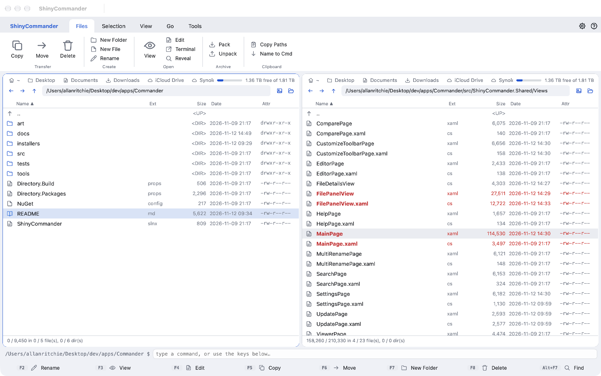
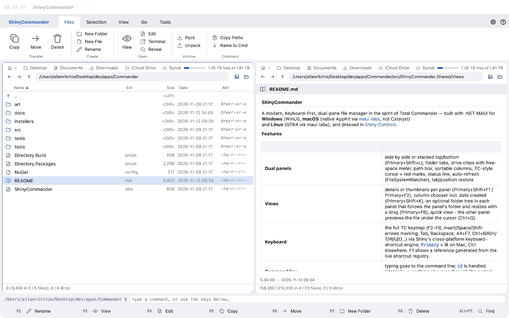
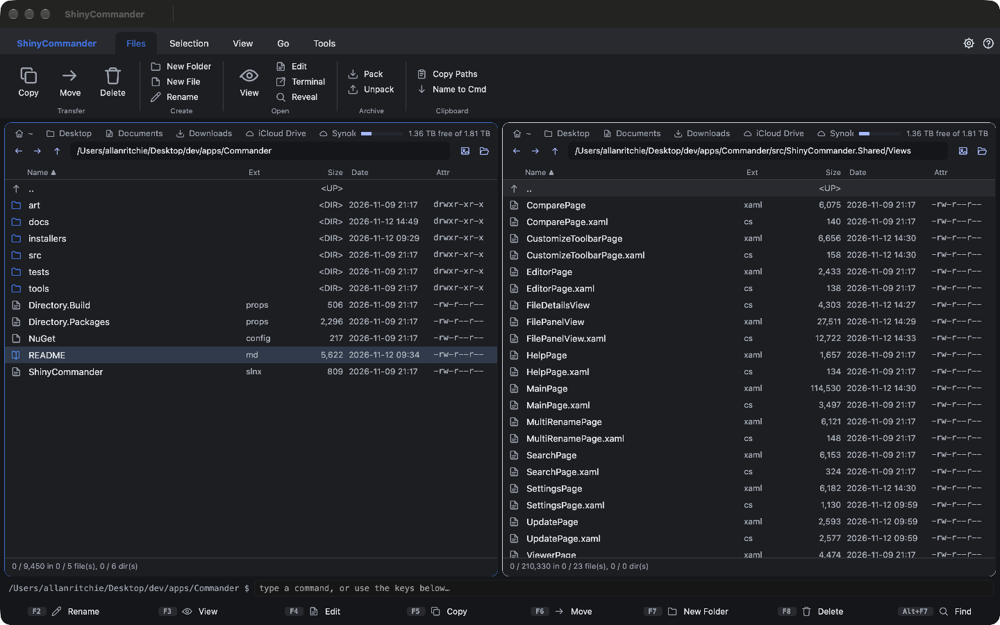
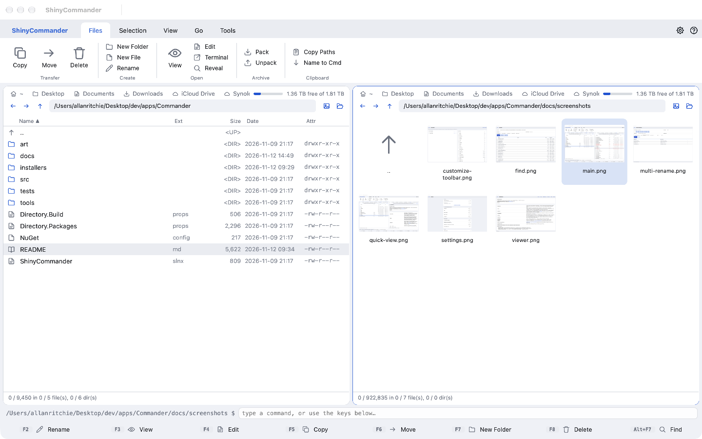
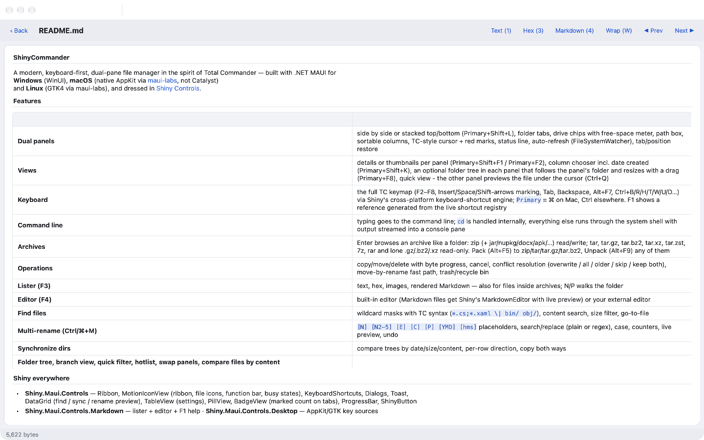
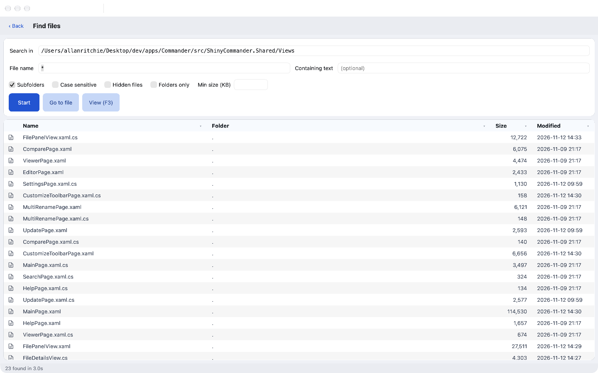
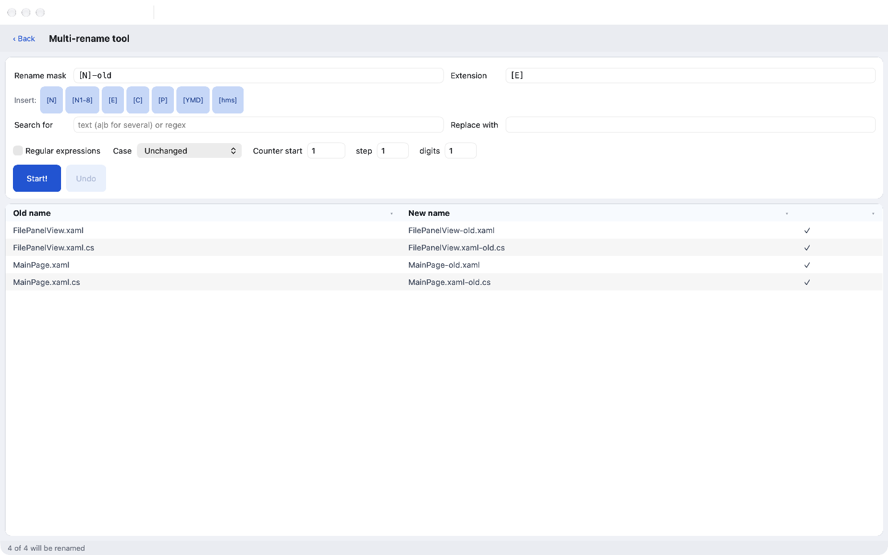
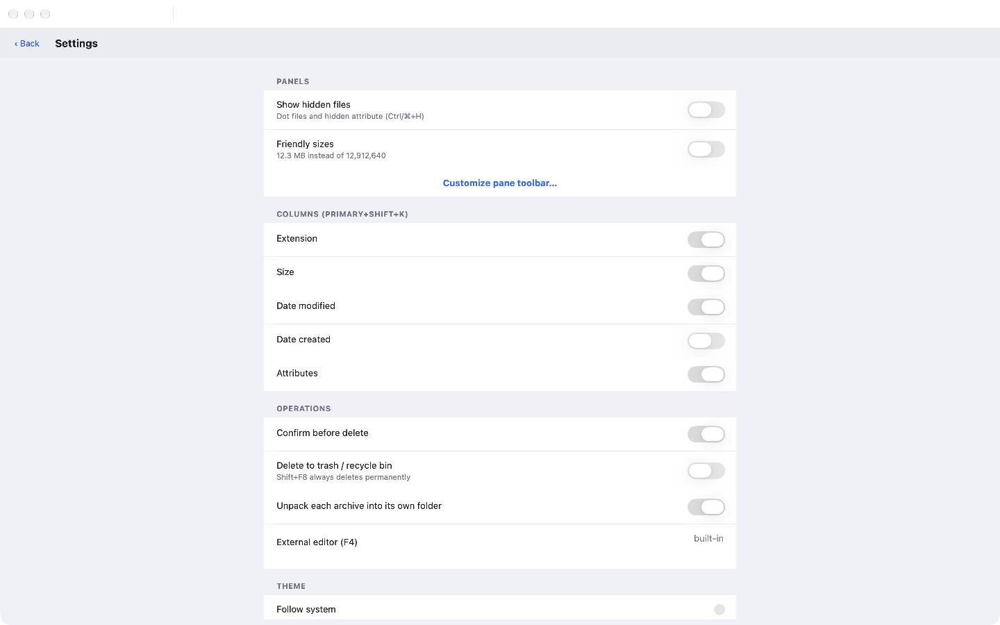
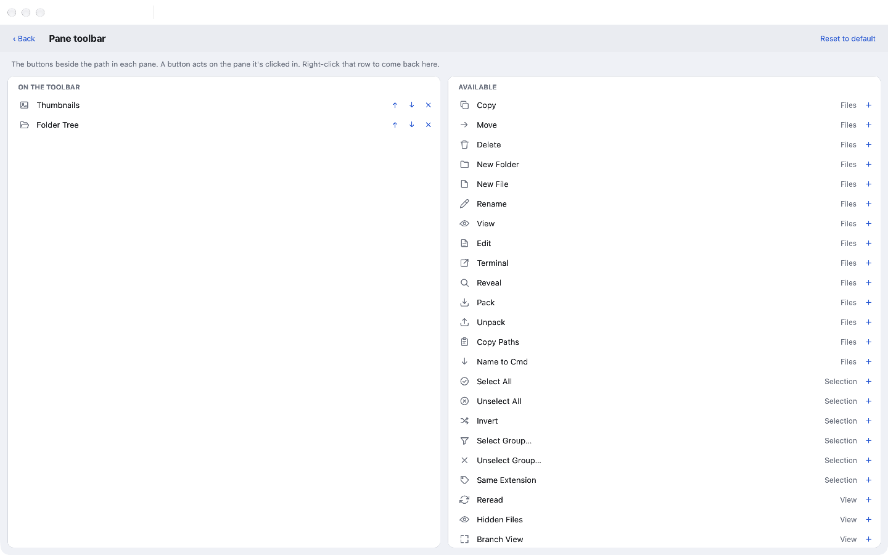

# ShinyCommander

A modern, keyboard-first, dual-pane file manager in the spirit of Total Commander — built with .NET MAUI for
**Windows** (WinUI), **macOS** (native AppKit via [maui-labs](https://github.com/dotnet/maui-labs), not Catalyst)
and **Linux** (GTK4 via maui-labs), and dressed in [Shiny Controls](https://github.com/shinyorg/controls).



| | |
|---|---|
| <br>**Quick view** - the other panel previews the file under the cursor | <br>**Dark mode** - follows the system, or pick one in Settings |
| <br>**Thumbnails** per panel | <br>**Lister (F3)** - text, hex, images and rendered Markdown |
| <br>**Find files (Alt+F7)** | <br>**Multi-rename** with a live preview |
| <br>**Settings** | <br>**Pane toolbar** - choose the buttons beside each path |

<sub>Regenerate with `tests/ShinyCommander.UITests/run.sh --readme-screenshots`.</sub>

## Features

| | |
|---|---|
| **Dual panels** | side by side or stacked top/bottom (Primary+Shift+L), folder tabs, drive chips with free-space meter, path box, sortable columns, TC-style cursor + red marks, status line, auto-refresh (FileSystemWatcher), tab/position restore |
| **Views** | details or thumbnails per panel (Primary+Shift+F1 / Primary+F2), column chooser incl. date created (Primary+Shift+K), an optional folder tree in each panel that follows the panel's folder and resizes with a drag (Primary+F8), quick view - the other panel previews the file under the cursor (Ctrl+Q) |
| **Keyboard** | the full TC keymap (F2–F8, Insert/Space/Shift-arrows marking, Tab, Backspace, Alt+F7, Ctrl+B/R/H/T/W/U/D…) via Shiny's cross-platform keyboard-shortcut engine; `Primary` = ⌘ on Mac, Ctrl elsewhere. F1 shows a reference generated from the live shortcut registry |
| **Command line** | typing goes to the command line; `cd` is handled internally, everything else runs through the system shell with output streamed into a console pane |
| **Archives** | Enter browses an archive like a folder: zip (+ jar/nupkg/docx/apk/…) read/write; tar, tar.gz, tar.bz2, tar.xz, tar.zst, 7z, rar and lone .gz/.bz2/.xz read-only. Pack (Alt+F5) to zip/tar/tar.gz/tar.bz2, Unpack (Alt+F9) any of them |
| **Operations** | copy/move/delete with byte progress, cancel, conflict resolution (overwrite / all / older / skip / keep both), move-by-rename fast path, trash/recycle bin |
| **Lister (F3)** | text, hex, images, rendered Markdown — also for files inside archives; N/P walks the folder |
| **Editor (F4)** | built-in editor (Markdown files get Shiny's MarkdownEditor with live preview) or your external editor |
| **Find files** | wildcard masks with TC syntax (`*.cs;*.xaml \| bin/ obj/`), content search, size filter, go-to-file |
| **Multi-rename (Ctrl/⌘+M)** | `[N] [N2-5] [E] [C] [P] [YMD] [hms]` placeholders, search/replace (plain or regex), case, counters, live preview, undo |
| **Synchronize dirs** | compare trees by date/size/content, per-row direction, copy both ways |
| **Folder tree, branch view, quick filter, hotlist, swap panels, compare files by content** | |

## Shiny everywhere

* **Shiny.Maui.Controls** — Ribbon, MotionIconView (ribbon, file icons, function bar, busy states), KeyboardShortcuts, Dialogs, Toast,
  DataGrid (find / sync / rename preview), TableView (settings), PillView, BadgeView (marked count on tabs), ProgressBar, ShinyButton
* **Shiny.Maui.Controls.Markdown** — lister + editor + F1 help · **Shiny.Maui.Controls.Desktop** — AppKit/GTK key sources
* **Shiny.Maui.Shell** — ViewModel-first navigation (`[ShellMap]`, `[ShellProperty]`) · **Shiny.Mediator** — file-system-changed / go-to events
* **Shiny.Extensions.Stores + DependencyInjection** — `[Bind]` persisted settings, `[Singleton]` registration
* **SharpCompress** — 7z / rar / compressed-tar reading (System.IO.Compression for zip, System.Formats.Tar for writing tars)

## Layout

```
src/ShinyCommander.Core      net10.0 - VFS (disk + archives), operations, search, multi-rename, compare  (no MAUI)
src/ShinyCommander.Shared    shared MAUI UI as linked source (ShinyCommander.Shared.props)
src/ShinyCommander.Windows   net10.0-windows WinUI head
src/ShinyCommander.MacOS     net10.0-macos AppKit head (maui-labs)
src/ShinyCommander.Linux     net10.0 GTK4 head (maui-labs)
tests/ShinyCommander.Core.Tests
tools/ribbon.py              generates the ribbon markup from one command table
tests/ShinyCommander.UITests UI tests driving the real macOS app via DevFlow (docs/testing.md)
docs/ROADMAP.md              planned: custom button bar + user commands, side-by-side file diff
docs/RELEASING.md            tag a version → signed/notarized macOS, Windows installer, Linux .deb/.rpm
```

The UI is shared as linked source because there's no Linux TFM and each head compiles its own XAML and source
generators — the same pattern maui-labs and Shiny's own samples use.

## Testing

```bash
dotnet test tests/ShinyCommander.Core.Tests                 # core, ~1s
tests/ShinyCommander.UITests/run.sh                         # the real macOS app through MAUI DevFlow, ~5 min
tests/ShinyCommander.UITests/run.sh --no-build -t F5_copies # one test, seconds (attaches to the running test app)
```

The UI suite never types on your desktop or touches your settings - see [docs/testing.md](docs/testing.md).

## Build & run

```bash
dotnet test tests/ShinyCommander.Core.Tests

# macOS (AppKit)
dotnet build src/ShinyCommander.MacOS && open src/ShinyCommander.MacOS/bin/Debug/net10.0-macos/osx-arm64/ShinyCommander.app

# Linux (needs GTK 4 / WebKitGTK typelibs - see the maui-labs Linux.Gtk4 README)
dotnet run --project src/ShinyCommander.Linux

# Windows (on Windows)
dotnet build src/ShinyCommander.Windows
```

## Platform notes

* **macOS AppKit:** Shiny's `Ribbon` body doesn't draw on the AppKit head yet (it builds its tab bodies after the
  native view exists), so that head swaps in a ribbon-styled bar generated from the same command table
  (`tools/ribbon.py`). Windows and Linux use the Shiny Ribbon directly.
* Row/tab visuals use converters rather than `DataTrigger`s because the AppKit backend doesn't restore trigger
  setters on exit.
